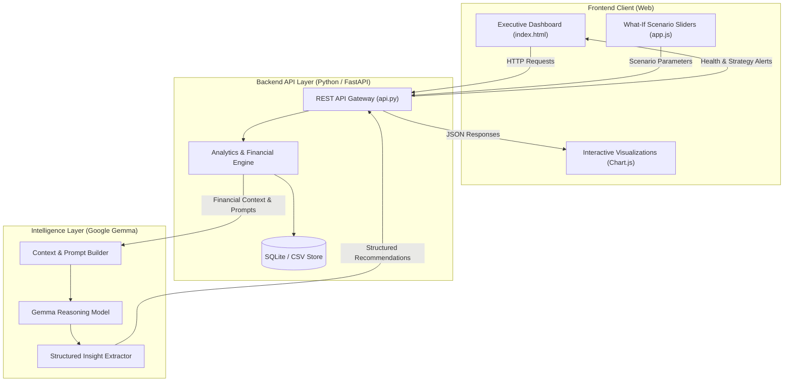

# 🌟 Merchant AI Box — AI Growth Advisor

<div align="center">


**An Autonomous Business Operating & Intelligence System for SMEs — Powered by Google Gemma**

[Explore Features](#-features) • [Architecture](#-system-architecture--gemma-workflow) • [API Specs](#-api-specifications) • [Quickstart](#-quickstart-guide) • [Team](#-team--hackathon-details)

</div>

---

## 📌 Team & Hackathon Details

- **Hackathon**: Hacktober 2026
- **Team Identifier**: `T15 - Clover Dynamics`
- **Repository**: [Hackotber-26/T15-Clover-Dynamics](https://github.com/Hackotber-26/T15-Clover-Dynamics.git)
- **Track**: AI for Business Operations / SME Financial Resilience

### 🎯 The Problem Statement
Small and Medium Enterprises (SMEs) represent over 90% of global businesses, yet more than 50% fail within five years due to:
1. **Unforseen Cashflow Crunches**: Latent receivables and delayed payment cycles leading to sudden insolvency.
2. **Suboptimal & Static Pricing**: Pricing based on gut feeling rather than demand elasticity, margins, and market shifts.
3. **Supplier Risk & Fragile Supply Chains**: Unmonitored delays, erratic quality spikes, and unfavorable procurement terms.
4. **Lack of Dedicated Financial Analysts**: High consultancy costs preventing small merchants from accessing data-backed growth strategies.

### 💡 The Solution: Merchant AI Box
**Merchant AI Box** acts as an on-premise/edge AI Chief Financial Officer and Growth Co-Pilot. By fusing historical transaction data with the reasoning capabilities of **Google Gemma**, it delivers real-time business health monitoring, dynamic pricing intelligence, supplier risk scoring, and interactive scenario forecasting.

---

## 🚀 Features

### 1. 📊 Executive Dashboard & Real-Time KPIs
- Continuous tracking of Net Revenue, Gross Margin, Burn Rate, and Accounts Receivable aging.
- Real-time **Business Health Index (0-100)** computed dynamically from liquidity, profitability, and operational velocity.

### 2. 🧠 Gemma-Powered Pricing Advisor
- Computes price elasticity of demand across catalog SKUs.
- Leverages **Google Gemma** to synthesize competitor benchmarks, inflation pressures, and inventory levels into contextual pricing adjustment recommendations with chain-of-thought rationale.

### 3. 🔍 Supplier Intelligence & Procurement Optimizer
- Multi-dimensional scoring for supplier On-Time Delivery (OTD), Quality Defect Rate (PPM), and Unit Cost Variance.
- Gemma-generated supplier negotiation briefs and diversification recommendations to eliminate single-point-of-failure vendors.

### 4. 🎛️ Growth & "What-If" Scenario Simulator
- Interactive simulation engine allowing merchants to test operational decisions:
  - *"What if we raise prices by 8% while raw material costs rise by 4%?"*
  - *"How does offering a 2% early-payment discount improve our 90-day cash runway?"*
- Real-time chart visualization of projected net profit and liquidity trajectories.

### 5. 💬 Merchant AI Co-Pilot (Natural Language Advisory)
- Ask natural questions: *"Which supplier poses the highest risk this quarter?"* or *"How can I improve gross margin next month?"*
- Powered by Gemma with grounding in your local merchant datasets.

---

## 🏗️ System Architecture & Gemma Workflow



### Gemma Reasoning Workflow
1. **Data Ingestion**: Raw transaction, catalog, and supplier records are ingested and transformed into standardized financial metrics.
2. **Context Formulation**: Current merchant state (burn rate, top-selling SKUs, supplier variance) is synthesized into structured analytical prompts.
3. **Reasoning via Gemma**: The Gemma model processes the state with specialized system instructions to generate prioritized, actionable business advice.
4. **Structured Output**: AI responses are validated and delivered as actionable cards, alerts, and strategy playbooks in the merchant dashboard.

---

## 🛠️ Tech Stack

| Layer | Technologies |
|---|---|
| **Frontend** | HTML5, Modern CSS3 (Glassmorphism & Responsive Tokens), Vanilla JavaScript (ES6+), Chart.js |
| **Backend** | Python 3.10+, FastAPI / Flask, Uvicorn, Pydantic |
| **Data Engine** | SQLite, Pandas, NumPy |
| **AI / LLM** | Google Gemma (Gemma-2B / Gemma-7B / Gemma 2 via Transformers / Ollama / Google GenAI) |
| **DevOps / VCS** | Git, GitHub, GitHub Actions |

---

## 📂 Project Structure

```text
Merchant AI box/
│
├── README.md               # Hackathon & Project Documentation
├── index.html              # Main Executive Dashboard UI
├── styles.css              # Modern CSS Design System & Responsive Layout
├── app.js                  # Frontend Controller, Event Listeners & Chart.js Config
├── api.py                  # Python FastAPI/Flask Backend & Gemma Engine
├── requirements.txt        # Python Dependencies
├── .gitignore              # Ignored files & virtual environments
│
└── data/                   # Sample Datasets
    ├── products.csv        # Product catalog, pricing, elasticity & margins
    ├── suppliers.csv       # Supplier metrics (OTD, quality, cost variance)
    └── transactions.csv    # Historical sales, receivables, and cashflows
```

---

## ⚡ Quickstart Guide

### Prerequisites
- Python 3.10 or higher
- Git
- Modern Web Browser (Chrome, Edge, Firefox, Safari)

### 1. Clone the Repository
```bash
git clone https://github.com/Hackotber-26/T15-Clover-Dynamics.git
cd T15-Clover-Dynamics
```

### 2. Set Up Virtual Environment & Dependencies
```bash
# Create virtual environment
python -m venv venv

# Activate virtual environment
# On Windows (PowerShell):
.\venv\Scripts\Activate.ps1
# On macOS / Linux:
source venv/bin/activate

# Install dependencies
pip install -r requirements.txt
```

### 3. Launch Backend API
```bash
python api.py
```
*The API server will start at `http://127.0.0.1:8000` (or `http://localhost:5000`).*

### 4. Launch the Dashboard
Open `index.html` in your web browser, or serve it via a local static server:
```bash
# Using Python's built-in HTTP server:
python -m http.server 3000
```
Visit `http://localhost:3000` to access the **Merchant AI Box**.

---

## 🔌 API Specifications

| Method | Endpoint | Description |
|---|---|---|
| `GET` | `/api/dashboard/kpis` | Returns real-time financial metrics, runway days, and health score |
| `GET` | `/api/pricing/recommendations` | Computes AI-driven pricing adjustments and elasticity trends |
| `GET` | `/api/suppliers/metrics` | Returns supplier performance ratings, delivery scores, and risk flags |
| `POST` | `/api/simulator/forecast` | Runs what-if simulations based on price, volume, and cost sliders |
| `POST` | `/api/ai/advisor` | Handles natural language merchant queries powered by Gemma |

---

## 👥 Team — Clover Dynamics (T15)

Developed with ❤️ by **Team T15 (Clover Dynamics)** for **Hacktober 2026**:

| Name / Handle | Role | Focus Areas |
|---|---|---|
| **Adithya Kumar** | Lead Developer | System Architecture, Gemma AI Reasoning & Full Stack |
| **Clover Dynamics Team** | Engineering & Product | Financial Modeling, Frontend UX & Data Engineering |

---

## 📄 License
This project is licensed under the [MIT License](LICENSE).
